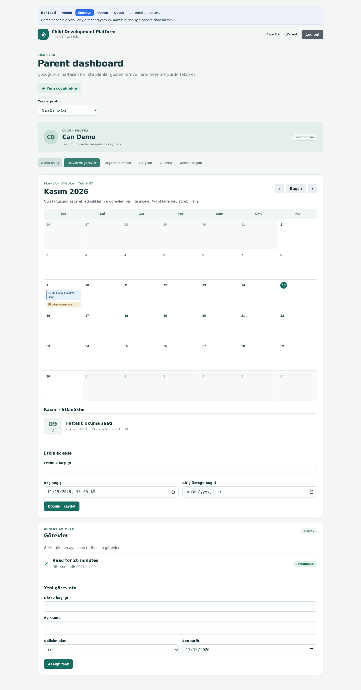

# Çocuk gelişim platformu uygulama ve doğrulama raporu

15 Kasım 2026 · Yerel dal: `codex/admin-operations`

## Sonuç ve kapsam

Bu çalışma, mevcut login/uzman bağlantısı altyapısını koruyarak M3 takvim,
M4 görevler, M6 belgeler ve M7 istatistiklerini frontend ve backend birlikte
uygular. M8'in mock/test akışı kaynak kayıtlar, role göre ayrılan çıktı, kayıtlı
özet geçmişi ve geri bildirimle tamamlanmıştır. Gerçek Gemini/GitHub Models
entegrasyonu bu çalışmada uygulanmamıştır; mock olması ekranda açıkça belirtilir.
Önceki isteklerle eklenen çocuk oluşturma, haftalık uzman değerlendirmesi, admin
paneli ve rol testi de yeni çalışma alanına entegredir.

Kod, yerel uygulama ve otomatik testlerle doğrulandı. GitHub'a push, PR oluşturma,
merge, release tag'i veya Jira durum değişikliği bu çalışma kapsamında yapılmadı.
Dolayısıyla aşağıdaki yerel sonuçlar uzak GitHub Actions çalışmasının yeşil olduğu
anlamına gelmez. Dersin nihai teslimindeki gerçek AI şartı ayrıca tamamlanmalıdır.

## Gereksinim ve iş eşlemesi

| İş | İlgili gereksinimler | Uygulanan davranış | Neden |
|---|---|---|---|
| G4-27 / G4-33, M3 | FR-M3-01–03 | Parent/bağlı specialist etkinlik ekler; seçilen haftada listelenir; child yalnızca kendisininkini görür | Planın API ve ekran tarafını birlikte tamamlamak |
| G4-34 / G4-35, M4 | FR-M4-01–04 | Görev atama, child'ın tamamlaması ve atayanın sonucu görmesi | SRS Flow 2'yi gerçekten çalıştırmak |
| M6 | FR-M6-01–05 | PDF/PNG/JPEG yükleme, listeleme, görüntüleme ve indirme | Belgeyi sadece UI'da değil yetkili API üzerinden sunmak |
| M7 | FR-M7-01–02 | Haftalık toplam ve gelişim alanına göre tamamlanma | Sabit örnek yüzdeler yerine gerçek SQLite verisi kullanmak |
| M8 mock | FR-M8-01–08'in mock akışı | Haftalık izinli kaynaklardan deterministik role göre özet, kaynaklar, etiket ve feedback | CI'da API anahtarsız, ağ çağrısız test edilebilen özet |
| E2E / CI | SRS kritik akışlar 1–3 | Playwright ve GitHub Actions adımları | Tabloların veya endpoint'lerin varlığından öte kullanıcı akışını doğrulamak |

M5 uzman değerlendirmeleri ile M8 AI özeti ayrıdır. Uzman değerlendirmesi insanın
yazdığı bir kayıttır; AI mock bu kayıtların sayısal bağlamını ve kaynaklarını
kullanır. Değerlendirme metinlerini yorumlayan gerçek bir dil modeli çalışmaz.

## Yeniden kullanılan altyapı

- `authenticate` ve `requireRole`: her istekte kullanıcıyı/veritabanındaki güncel
  rolünü doğrular. Body içindeki rol veya ebeveyn ID'si yetki kaynağı değildir.
- `canAccessChild`: parent sahipliğini, specialist'in güncel bağlantısını ve child
  hesabının eşleşmesini kontrol eder. Yeni çocuk kaynakları aynı kontrolü kullanır.
- Mevcut `children`, `users`, `specialist_links` ve `entries` kayıtları korundu.
- Frontend `apiFetch`, `useAuth` ve `useChildren` genişletildi; paralel bir login
  sistemi veya kopya token mekanizması yazılmadı.
- Admin rol testi gerçek demo kullanıcı yetkileriyle çalışır. Parent/teacher/child
  önizlemesi admin ayrıcalıklarını yeni modüllere taşımaz.

## M3 takvim

`server/src/events.js`, `validation.js` ve mevcut ISO hafta yardımcıları kullanılır.
GET, `year` ve `week` veya Pazartesi olan `weekStart` kabul eder. Filtre aralığı
Pazartesi dahil, bir sonraki Pazartesi hariçtir. Başlangıç tarihine göre sıralanır.
POST başlık, başlangıç ve isteğe bağlı bitiş alır; geçersiz gün/saat, boş başlık
ve başlangıçtan önce/eşit bitiş reddedilir. Parent ve bağlı uzman yazabilir;
child kendi etkinliklerini okuyabilir ama oluşturamaz.

UI, pazartesi başlayan 42 gün kutulu aylık yaprak takvimidir. Etkinlikler gün
kutularında, görev sayıları aynı günün altında görünür. Gün seçimi alt etkinlik
ve görev listelerini birlikte filtreler. Ayı oklarla değiştirme ve Bugün düğmesi
vardır. Mobilde yedi sütun birlikte görünür. Tekrar eden etkinlikler eklenmedi.

## M4 görevler

`server/src/tasks.js` görev API'sini uygular. Eski, login gerektirmeyen
`GET /api/tasks` kaldırıldı. Yeni liste `/api/children/:childId/tasks` yolundadır.
Atamada başlık, açıklama, alan ve son tarih alınır; atayan ve çocuk kimlikleri
session/route'dan gelir. Alanlar language, motor, social, cognitive ve self_care.

`PATCH /api/tasks/:taskId/complete` sadece görevin child hesabına aittir. Bir
parent, specialist veya farklı child görev tamamlayamaz. Tekrar tamamlamak tarihi
her seferinde değiştirmez. Çocuk Undone/Yapılmadı ile görevi open durumuna
alabilir; completed_at temizlenir. İstatistik ve atayanın listesi bunu yansıtır.
`assigned-by-me` atayanı filtreler ve specialist linkini
yeniden kontrol eder; geçmişte görev atamış olmak kalıcı erişim sağlamaz.

Görevler ayrı sekme yerine Takvim ve görevler ekranının alt başlığıdır.
Seçilen gün veya görüntülenen ayın görevleri listelenir. UI görev formu, açıklama,
alan, son tarih ve durum gösterir. Child'ın uygun
satırlarında `Mark as done` vardır. Specialist'in ayrı Atadığım görevler sekmesi,
child tamamladıktan sonra `done` durumunu görür. Çocuğun görev listesi tüm tarihleri
gösterir; haftalık istatistikler ayrıca son tarih filtresi uygular.

## M6 belgeler

`server/src/documents.js` multipart `file` alanını işler. En fazla 5 MB bir dosya
alınır. Desteklenen biçimler PDF, PNG ve JPEG'dir; MIME ve başlangıç imzası birlikte
kontrol edilir. HTML/script metnini `.pdf` diye yeniden adlandırmak kabul edilmez.
Bu kontrol tam bir antivirüs veya tam dosya biçimi çözümlemesi değildir.

Dosyanın hem metadata bilgisi hem de içeriği SQLite'da tutulur. İçerik
`documents.file_data` BLOB alanındadır. `stored_name` eski şema uyumluluğu için
bir iç anahtar olarak kalır; yeni bir disk dosyası veya statik klasör oluşturmaz.
Görüntüleme ve indirme, yetki kontrolünden sonra BLOB'u okur.

Eski `server/uploads` dosyaları seed sırasında dönüştürülür: boyut doğrulanır,
byte'lar DB'ye commit edilir, DB'den geri okunup birebir karşılaştırılır, sonra
eski dosya kaldırılır. Kesilmiş temizleme işlemi tekrar denenebilir. Eksik veya
boyutu uyuşmayan eski dosya boş veriyle değiştirilmez. Geliştirme veritabanındaki
mevcut bir belgenin BLOB'a geçtiği ve uploads'ta dosya kalmadığı ayrıca doğrulandı.
Liste ad, MIME, boyut, yükleyen ve zamanı gösterir; BLOB liste cevabına dahil
edilmez. Child yükleyemez, listeleyemez veya indiremez.

Frontend FormData'yı Content-Type'ı kendisi ayarlamadan gönderir; dosya indirmede
bearer token ve admin önizleme başlığı korunur. Görüntüle, yeni sekmede dosyayı
açar; İndir özgün adı kullanır. İkisi de tarayıcı testinde denendi.

## M7 istatistikler

`server/src/stats.js` seçilen haftada **son tarihi olan** görevleri gruplar. Payda
o hafta için toplam görev, pay tamamlanan görevdir. Yüzde bir ondalığa yuvarlanır;
boş hafta %0 döner. Aynı mantık her gelişim alanı için uygulanır. Tamamlama zamanı
farklı bir haftaya denk gelse de görev, dokümandaki tanıma uygun biçimde son tarih
haftasına dahildir.

Frontend sayısal toplam, tamamlanma yüzdesi ve beş alan için progress göstergesi
sunar. Task tamamlandıktan sonra Genel bakışa dönmek güncel hesabı API'den alır.

## M8 mock AI

`server/src/ai.js` tek sağlayıcı sınırıdır. Varsayılan `AI_MODE=mock` ağ çağrısı
yapmaz; parent ve specialist için ayrı sabit şablon/prompt kullanır. Çıktı kayıtlı
görev sayıları, tamamlanma oranı, değerlendirme ve etkinlik adetlerini deterministik
biçimde özetler. Kaynak değerlendirmelerdeki talimatlar işlenmez; mock teşhis,
tedavi veya karar üretmez. Aynı rol ve aynı kayıtlar aynı metni verir. Veri yoksa
kayıt olmadığını belirtir; sahte gelişim bulgusu oluşturmaz.

Akış:

1. Oturum ve güncel çocuk erişimi doğrulanır.
2. Seçilen haftanın o çocuğa ait görevleri, değerlendirmeleri ve etkinlikleri alınır.
3. İlgili role ait mock şablon, gerçek kayıtların sayısal bağlamıyla sonuç verir.
4. Özet ile kaynakların özet anındaki kopyaları tek transaction içinde saklanır.
5. UI `AI-generated`, `mock` ve okuyucu rolünü gösterir.
6. Kaynak düğmeleri özgün başlık/metin/tarih/durum bilgilerini açar.
7. Yararlı/Hatalı geri bildirimi SQLite'a kaydedilir ve yenilemede korunur.

Kaynaklar summary ID ve child ID ile sınırlıdır. Özetler ayrıca oluşturucu kullanıcı
ve okuyucu rolüne göre ayrılır. Bir specialist, parent'ın kayıtlı özetine URL'yi
bilerek erişemez. Uzman bağlantısı kaldırılırsa kendi eski özetinin kaynaklarını
da açamaz. Child bu ekranlara ve API'lere erişemez.

Gerçek API entegrasyonu henüz yoktur. `AI_MODE` başka bir değer olursa 503 döner;
sistem sessizce mock'a dönüp gerçek sağlayıcı çalışıyormuş izlenimi vermez.
PDF/resim içeriğini AI'ye gönderme, OCR veya belge metni çıkarma uygulanmadı.
Klinik yorum ve karar verme ödevin zaten yasakladığı kapsamdır.

## Veritabanı değişiklikleri

Tasks'a child_id, assigned_by, description, area, due_date ve completed_at eklendi.
Mevcut sentetik satırların id/title/status bilgileri silinmedi. Eski skeleton
satırları demo çocuk ve atayana bağlandı; boş tarihler mevcut haftayla tamamlandı.
Yeni tablolar events, documents, ai_summaries, ai_summary_sources ve ai_feedback.
Önceki entries tablosu ve uzman notları aynı biçimde kullanıldı.

Seed tekrar çalıştırıldığında silinmiş uzman bağlantısının yeniden gelmesi düzeltildi.
Varsayılan link yalnızca demo çocuk ilk oluşturulduğunda eklenir. Startup kontrolü
artık yeni kolon ve tabloları da kontrol eder; eksikse kullanıcıya seed çalıştırmasını
söyler. Şema yükseltmesinin eski görevleri koruması otomatik testtedir.

## Arayüz değişiklikleri ve nedenleri

Önceden peş peşe eklenen formlar yerine çocuk bağlamını koruyan
sekme yapısı kullanıldı. Son güncellemede üstte yalnızca çocuk seçici bırakıldı;
yıl/hafta kontrolleri değerlendirme, istatistik ve AI bölümlerine taşındı. Böylece
hangi çocuğun hangi dönemi üzerinde çalışıldığı
sürekli görünür. Parent: Genel bakış, Takvim ve görevler, Değerlendirmeler, Belgeler,
AI özeti ve Uzman erişimi. Specialist'te son sekme Atadığım görevler olur. Child'ın
ekranı birleşik Takvim ve görevler görünümüdür.

Ortak renkler, okunabilir tipografi, boşluklar, kartlar, durum rozetleri, çocuk
baş harfleri ve tarih kartları eklendi. Formlarda boş/hata/başarılı/kaydediliyor
halleri vardır. Mobilde iki kolon tek kolona iner; sekmeler yatay kayar ve sayfa
kendisi dışarı taşmaz. Kaynaklar teknik JSON yerine okunabilir kayıt bilgisiyle
sunulur. Mock etiketi, ürün kullanıcısının hangi özeti gördüğünü anlaması için
korundu; modül numaraları son kullanıcı başlıklarından çıkarıldı.

`WorkspacePanels.jsx` görev/takvim/belge/istatistik/özet panellerini;
`RoleHomes.jsx` rol ve çocuk bağlamını; `week.jsx` ortak hafta seçimini içerir.
Mevcut AddChild, LinkedSpecialists ve WeeklyEvaluations bu yapıya yerleştirildi.

## Doğrulama sonuçları

| Kontrol | Sonuç |
|---|---|
| Jest/Supertest | 7 suite, 64 test geçti |
| Backend branch coverage | %85,00, 255/300 branch |
| Backend line coverage | %92,33, 458/496 satır |
| Backend function coverage | %94,62 |
| Vitest | 6 ISO hafta ve aylık takvim testi geçti |
| Playwright | 7 E2E testi geçti |
| Frontend production build | Başarılı |
| git diff --check | Başarılı |
| 390 px mobil inceleme | Yedi parent sekmesinde yatay sayfa taşması yok |
| Tarayıcı JavaScript hataları | Görsel inceleme akışında yok |

Coverage yalnızca yüklenmiş modüllerle sınırlandırılmadı: `src/**/*.js` dahil edildi.
Başlangıç/seed scriptleri Jest'in subprocess coverage'ına girmediği için bu iki
dosya raporda %0 görünebilir; npm seed/start komutları ayrıca gerçekten çalıştırıldı.
CI'da global branch coverage eşiği %60 olarak tanımlıdır.

Playwright akışları: yanlış login/oturum yenileme; parent'ın specialist bağlayıp
çıkarması; specialist görev atar → child tamamlar → specialist done görür;
parent mock özet/kaynak/feedback; takvim ve dosya upload/view/download;
admin rol önizleme ve mobil; specialist değerlendirmesi ve parent'ın okuması.
E2E 3100/5174 portlarında geçici SQLite kullanır; belgeler bu DB içinde BLOB
olarak saklanır. Geliştirme
veritabanına veya çalışan 3000/5173 uygulamasına test verisi yazmaz.

Backend testleri ayrıca başka çocuğa erişimi, child'a yasak verileri, geçersiz
tarih/alan/haftayı, boş istatistikleri, sahte PDF'i, 5 MB sınırını, non-mock modda
503'ü, kaynak izolasyonunu ve aynı token'la unlink sonrası erişimi kapsar.

Frontend bağımlılıkları Vite 7 / React Router 7 / Vitest 4'e güncellendi. npm 10'un
peer-resolution hatası nedeniyle yükseltmede geçici npm 11 kullanıldı; ardından
normal npm 10 ile temiz `npm ci`, test ve build başarılı oldu. Frontend audit
0 açık raporladı. Backend production bağımlılıklarında da 0 açık raporlandı;
tüm backend geliştirme araçları dahil edildiğinde audit'te 3 düşük ve 16 orta
seviye bulgu kalıyor. Bunlar giderilmiş gibi sunulmuyor; zorlamalı major yükseltme
yapılmadı.

## CI ve teslim durumu

Workflow backend kurulum/seed/coverage, frontend kurulum/Vitest/build, Playwright
kurulum/Chromium ve E2E adımlarını içerir. AI mock modu açıkça seçilir. Başarısız
E2E için trace, screenshot ve HTML raporu artifact olarak alınır. Uzak CI henüz
bu yerel değişikliklerle tetiklenmedi.

Özellikler tek mevcut yerel dalda, önceki isteklerden kalan değişiklikler korunarak
hazırlandı. Ayrı Jira işlerine göre PR ayırma, review, merge ve v0.1/v0.2 tag işlemleri
henüz yapılmadı. Jira görevleri otomatik Done'a taşınmadı.

## Çalıştırma ve deneme sırası

1. `server/` içinde `npm ci`, `npm run seed`, `npm start`.
2. Ayrı terminalde `client/` içinde `npm ci`, `npm run dev`.
3. http://localhost:5173 adresini aç.
4. Admin: admin@admin.com / admin. Rol testiyle Ebeveyn, Uzman ve Çocuk'a geç.
5. Uzman → Takvim ve görevler → Assign task. Çocuk → Mark as done. Uzman → Atadığım görevler.
6. Parent/uzman → Takvim ve görevler; ay/gün seç. Değerlendirmeler sekmesinde yıl/hafta seç.
7. Parent → Belgeler → sentetik PDF/PNG/JPEG yükle, görüntüle, indir.
8. Parent → AI özeti → Özet oluştur → kaynak aç → Yararlı/Hatalı.
9. `server/`: `npm run test:coverage`; `client/`: `npm test`, `npm run build`.
10. `e2e/`: `npm ci`, `npx playwright install chromium`, `npm test`.

Normal demo hesapları parent@demo.test, teacher@demo.test, psychologist@demo.test
ve child@demo.test; şifreleri Demo1234!. Yeni child profili oluşturmak login hesabı
oluşturmaz. Sonradan eklenen çocuk, bir uzman bağlanmadan o uzmanın listesine girmez.

## Görsel kanıt

[Mobil aylık takvim](img/calendar-mobile.png)

## Son istekte yapılan ek değişiklikler

- Çocuğun yalnızca kendi görevi için PATCH /api/tasks/:id/undo eklendi.
- Profil hizasındaki genel yıl/hafta kutuları kaldırıldı.
- Görev ve takvim sekmeleri birleştirildi; aylık yaprak görünümü eklendi.
- Etkinlikler gün kutularına, görevler aynı ekranın alt başlığına bağlandı.
- Yeni dosya yüklemeleri disk yerine BLOB'a alındı; eski belge için doğrulamalı
  geçiş uygulandı. Geçiş öncesi geliştirme DB yedeği /tmp altında alındı.
- Testler undo yetkileri, istatistik değişimi, artık yıl/ay sınırı, BLOB'a geçiş,
  eksik/uyuşmayan dosya ve mobil takvim sütunlarını kapsayacak şekilde genişletildi.

## Çocuk giriş hesabı güncellemesi

Ebeveyn artık çocuk ekleme formunda ad, soyad, e-posta ve şifre belirler. API e-postayı normalize eder, tüm kullanıcılar arasında tekrarını engeller; şifreyi bcrypt ile hashler. Şifre en az 8 karakter ve en fazla 72 UTF-8 baytıdır. Hesap rolü sunucuda child olarak sabittir; ebeveyn sahipliği oturumdan alınır. Kullanıcı ve profil tek DB transaction içinde oluşturulur, profil yazılamazsa hesap da geri alınır. Yeni hesap normal giriş ekranından kendi görevlerine erişir; diğer çocukların kayıtlarına, belgelere ve değerlendirmelere erişemez.

Doğrulama: backend 67 test; frontend 6 test ve production build; Playwright yeni hesap oluşturma/giriş/görev tamamlama dahil 8 senaryo.
