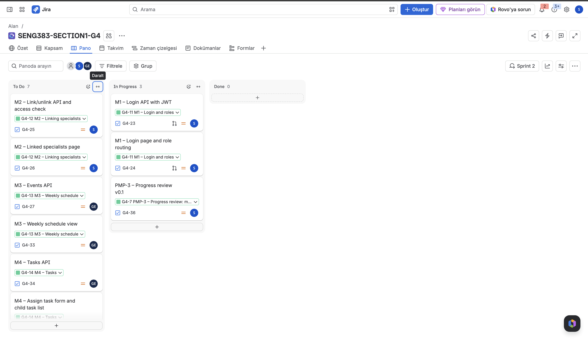

# Project Management Plan (PMP)

> The purpose of this PMP is to practice planning and tracking work in Jira. Keep it short: most of the content is a summary of what you set up in Jira.
> Keep this file at `docs/PMP.md`. Each section is one Jira epic (PMP-1 … PMP-6); mark the epic Done when the section is complete.
> Save screenshots in `docs/img/`.

| Section | Content | Required by |
|---|---|---|
| PMP-1 | Project, Jira setup, team and roles | Week 6 |
| PMP-2 | Work packages (epics) and sprint plan | Week 6 |
| PMP-3 | Progress review: mid-term (v0.1) | Mid-term evaluation (Week 8 / 9) |
| PMP-4 | Progress review: v0.2 | Week 10 |
| PMP-5 | Progress review: final (v1.0) | Final evaluation |
| PMP-6 | Retrospective | Final evaluation |

---

## PMP-1. Project and Team

### Project and Jira Setup

**Project in one sentence:** A web-based decision support platform where parents and specialists share one weekly schedule, task list and record of observations, with an AI summary that supports but never makes decisions.  
**Jira project key:** G4  
**Jira board link:** https://student-team-w5ttem13.atlassian.net/jira/software/projects/G4/boards/1  

### Team and Roles

| Name | Jira / GitHub username | Role |
|---|---|---|
| Selin Nur Seviş | c2328048@student.cankaya.edu.tr / selinsevis | Team lead & contact person, full-stack developer, Jira & PMP owner |
| Göktuğ Eskigöçmen | c202328025@student.cankaya.edu.tr / gokenomi | Full-stack developer, CI & testing owner |

---

## PMP-2. Plan

### Work Packages (Epics)

> One row per Jira epic. Number of tasks = how many tasks you created under that epic.

| Epic | Owner | Number of tasks | Planned sprint(s) |
|---|---|---|---|
| PMP-1 | Selin Nur Seviş | 0 (done before Sprint 1) | – |
| PMP-2 | Selin Nur Seviş | 1 | Sprint 1 |
| PMP-3 | Selin Nur Seviş | 1 | Sprint 2 |
| PMP-4 | Selin Nur Seviş | 1 | Sprint 3 |
| PMP-5 | Selin Nur Seviş | 1 | Sprint 4 |
| PMP-6 | Selin Nur Seviş | 1 | Sprint 4 |
| M1 | Selin Nur Seviş | 8 | Sprint 1, 2, 4 |
| M2 | Selin Nur Seviş | 3 | Sprint 2, 4 |
| M3 | Göktuğ Eskigöçmen | 3 | Sprint 2, 4 |
| M4 | Göktuğ Eskigöçmen | 3 | Sprint 2, 4 |
| M5 | Selin Nur Seviş | 3 | Sprint 3, 4 |
| M6 | Göktuğ Eskigöçmen | 3 | Sprint 3, 4 |
| M7 | Göktuğ Eskigöçmen | 3 | Sprint 3, 4 |
| M8 | Selin Nur Seviş | 3 | Sprint 3, 4 |

M1 also holds the Sprint 1 setup tasks: SRS first version (G4-57), SDD first version (G4-20), the walking skeleton (G4-21 backend, G4-22 frontend) and the README (G4-56).
Each module epic has its API and UI tasks in its development sprint, and its end-to-end test task in Sprint 4.

### Sprint Plan

> One row per Jira sprint. Align sprints with the weekly schedule.

| Sprint | Weeks | Sprint goal | Ends with |
|---|---|---|---|
| Sprint 1 | Week 6 (2–8 Nov) | SDD first version, PMP-2, walking skeleton (v0.0) | Walking skeleton (v0.0), Week 6 |
| Sprint 2 | Weeks 7–8 (9–22 Nov) | M1–M4 and PMP-3, release v0.1 | Release v0.1, mid-term |
| Sprint 3 | Weeks 9–10 (23 Nov–6 Dec) | M5–M8 and PMP-4, release v0.2 | Release v0.2, Week 10 |
| Sprint 4 | Weeks 11–12 (7–20 Dec) | End-to-end tests for M1–M8, coverage, PMP-5 and PMP-6 | Release v1.0, final |

---

## PMP-3. Progress Review: Mid-term (v0.1)

**Date of review:** 2026-11-15 (end of Week 7, middle of Sprint 2)

**Jira board screenshot:**

| Epic | Planned for this point | Status (Done / In progress / Not started) |
|---|---|---|
| PMP-1 | Project, Jira setup, team and roles | Done |
| PMP-2 | Work packages and sprint plan | Done |
| PMP-3 | Progress review at the end of Week 7 | In progress (this section) |
| M1 | Sprint 1: SRS, SDD, walking skeleton (v0.0), README · Sprint 2: login API with JWT (G4-23), login page and role routing (G4-24) | In progress: Sprint 1 tasks done and `v0.0` tagged; login API in review; login page not started |
| M2 | Link/unlink API with access check (G4-25), linked specialists page (G4-26) | Not started |
| M3 | Events API (G4-27), weekly schedule view (G4-33) | Not started |
| M4 | Tasks API (G4-34), assign task form and child task list (G4-35) | Not started |

**Work completed since PMP-2**

- Walking skeleton finished and tagged `v0.0`: SQLite → Express (`GET /api/tasks`) → React page (PRs #5, #8).
- README with setup steps, and `.gitignore` for database files, uploads and test output (PR #7).
- GitHub Actions workflow that installs, seeds, runs the backend tests and builds the frontend on every pull request.
- M1 login API (G4-23): synthetic demo users, hashed passwords, `POST /api/auth/login`, `GET /api/auth/me`, `authenticate` and `requireRole` middleware, with API tests.

**Remaining work in Sprint 2 (Week 8)**

M1 login page and role routing, M2, M3, M4, the first end-to-end test running in CI, and release `v0.1` for the mid-term demo.

**Changes to the plan (if any):**

- The final course schedule (announcement of 12 October) places PMP-3 in Week 7, PMP-4 at the mid-term in Week 8, PMP-5 in Week 10 and PMP-6 in Week 11. We moved the PMP-4 task (G4-45) to Sprint 2 and the PMP-5 task (G4-54) to Sprint 3; PMP-6 stays in Sprint 4.
- Two tasks were added to Sprint 1 after PMP-1: README (G4-56) and SRS first version (G4-57). Both are done.
- The collaboration with senior (SENG 440) students was cancelled by the instructor, so there is no separate test team. We hold a weekly team meeting instead and commit the notes to `docs/meetings/`.
- M2–M4 have not started yet, so most of Sprint 2 is concentrated in Week 8. To protect the mid-term demo, we will build the backend of M2 and M4 first, because the end-to-end test and the demo flow depend on them.

---

## PMP-4. Progress Review: v0.2

**Jira board screenshot:**  

| Epic | Planned for this point | Status (Done / In progress / Not started) |
|---|---|---|
| | | |
| | | |

**Changes to the plan (if any):**

---

## PMP-5. Progress Review: Final (v1.0)

**Jira board screenshot:**  

| Epic | Planned for this point | Status (Done / In progress / Not started) |
|---|---|---|
| | | |
| | | |

**Changes to the plan (if any):**

---

## PMP-6. Retrospective

- What worked well in using Jira:
- What we would do differently:
