# Software Design Document (SDD)

**Team name:** G4 (SENG383-SECTION1-G4)  
**Version:** ☒ First version (Week 6) ☐ Final (Week 10)  
**Last updated:** 2026-11-07

---

## 1. Architecture Overview

Our system is a client–server web application. The React frontend shows the screens and sends requests to our REST API. The Express backend checks the user's token and permissions, works with the SQLite database, and calls the AI service when a summary is requested. The frontend never talks to the database or the AI service directly.

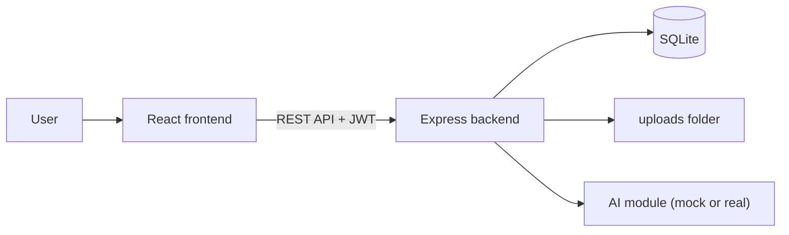

In the backend, each request goes through the same steps: the route, a middleware that checks the JWT, a middleware that checks the role and the link to the child, and then the controller and service. This way the access check is in one place and is not forgotten in any screen.

### Technology Stack

| Layer | Technology |
|---|---|
| Frontend | React (Vite), React Router |
| Backend | Node.js, Express, jsonwebtoken, bcrypt, multer |
| Database | SQLite, synthetic data from a seed script |
| AI | Gemini API, through one backend module with a mock mode |
| Testing | Jest + Supertest, Vitest, Playwright |
| CI | GitHub Actions |

The JWT secret and the AI key are kept in `server/.env`, which is not pushed to GitHub. Tests and CI always run with `AI_MODE=mock`.

---

## 2. Module Design

| Module | Main components | Implements requirements |
|---|---|---|
| M1 | Backend: auth routes, login service (bcrypt, JWT), `authenticate` and `requireRole` middleware. Frontend: login page, role-based routing. | FR-M1-01 … FR-M1-05 |
| M2 | Backend: link routes and service, `canAccessChild` middleware. Frontend: linked specialists page, specialist's children list. | FR-M2-01 … FR-M2-06 |
| M3 | Backend: event routes and service (filter by week). Frontend: weekly schedule view, add event form. | FR-M3-01 … FR-M3-03 |
| M4 | Backend: task routes and service. Frontend: assign task form, assigned tasks list, child's task page. | FR-M4-01 … FR-M4-04 |
| M5 | Backend: entry routes and service (sets `is_edited` on update). Frontend: entries list and form with "edited" label. | FR-M5-01 … FR-M5-04 |
| M6 | Backend: document routes, multer upload (PDF and images only), download. Frontend: documents page. | FR-M6-01 … FR-M6-05 |
| M7 | Backend: statistics service (completion rate, total and by area). Frontend: weekly statistics view. | FR-M7-01, FR-M7-02 |
| M8 | Backend: AI module with a parent prompt, a specialist prompt and a mock; summary service that selects allowed records. Frontend: summary card with "AI-generated" label and source links. | FR-M8-01 … FR-M8-07 |

**Access rules**

- **Parent:** only their own child.
- **Specialist:** only linked children. The link is checked in the database on every request, so after unlinking the specialist gets 403 even if their token is still valid.
- **Child:** only their own tasks and events. Entries, documents, statistics and summaries return 403.

The AI only receives records the reader is allowed to see. The prompts tell the model to use only the given records and not to diagnose, suggest treatment or make decisions.

---

## 3. Data Model

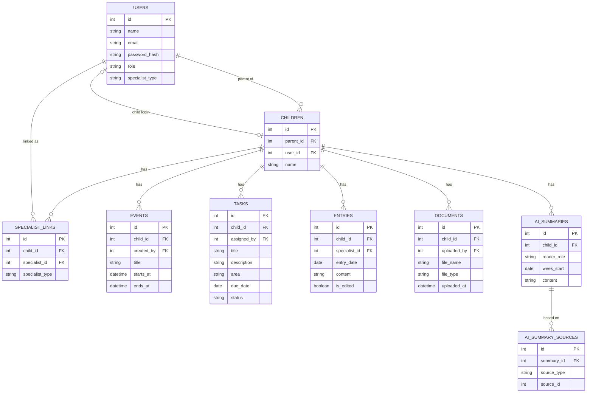

`role` is parent, specialist or child. `status` is open or done. A week starts on Monday.

---

## 4. API / Interfaces

All endpoints except login need a JWT in the `Authorization` header.

| Method | Endpoint | Description | Module |
|---|---|---|---|
| POST | `/api/auth/login` | Log in, returns JWT and role | M1 |
| GET | `/api/children` | Children the user can see | M1, M2 |
| GET | `/api/children/:id/specialists` | List linked specialists | M2 |
| POST | `/api/children/:id/specialists` | Link a specialist by email | M2 |
| DELETE | `/api/children/:id/specialists/:specialistId` | Unlink a specialist | M2 |
| GET | `/api/children/:id/events?week=` | Events of a week | M3 |
| POST | `/api/children/:id/events` | Add an event | M3 |
| GET | `/api/children/:id/tasks` | Tasks of the child | M4 |
| POST | `/api/children/:id/tasks` | Assign a task | M4 |
| PATCH | `/api/tasks/:taskId/complete` | Child marks a task as done | M4 |
| GET | `/api/tasks/assigned-by-me` | Tasks I assigned, with status | M4 |
| GET | `/api/children/:id/entries` | List entries | M5 |
| POST | `/api/children/:id/entries` | Add an entry | M5 |
| PUT | `/api/entries/:entryId` | Edit an entry (marked as edited) | M5 |
| GET | `/api/children/:id/documents` | List documents | M6 |
| POST | `/api/children/:id/documents` | Upload a document | M6 |
| GET | `/api/documents/:docId/download` | Download a document | M6 |
| GET | `/api/children/:id/stats?week=` | Weekly completion rate | M7 |
| POST | `/api/children/:id/summary` | Create the weekly AI summary | M8 |

Errors: 400 for invalid input, 401 for a missing or wrong token, 403 for no permission, 404 if not found.

---

## 5. Critical Flows

### Flow 1: Parent links a specialist; unlinked specialist is blocked

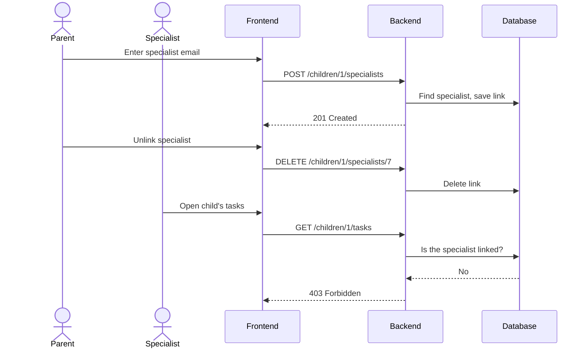

### Flow 2: Specialist assigns a task, child completes it

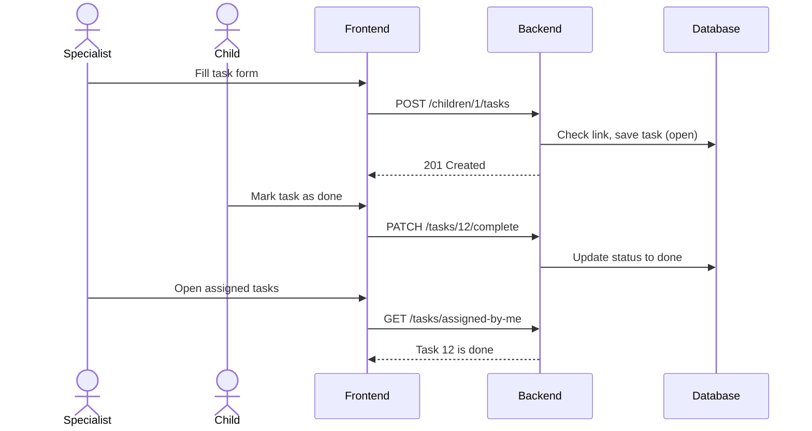

### Flow 3: Parent views the weekly AI summary

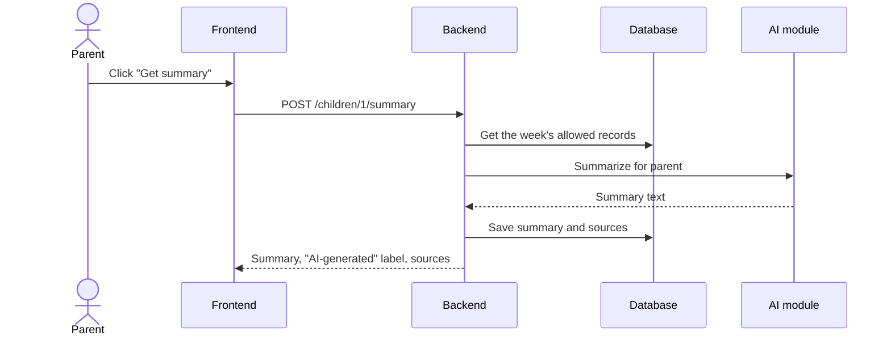

---

## 6. User Interface

Low-fidelity wireframes of the main screens. They show only the required functionality (M1–M8); the final look may change during development.

| Screen | Image | Module |
|---|---|---|
| Login | [wireframe-login.png](img/wireframe-login.png) | M1 |
| Parent dashboard (schedule, tasks, entries, statistics, AI summary) | [wireframe-parent-dashboard.png](img/wireframe-parent-dashboard.png) | M3, M4, M5, M7, M8 |
| Linked specialists | [wireframe-linked-specialists.png](img/wireframe-linked-specialists.png) | M2 |
| Documents | [wireframe-documents.png](img/wireframe-documents.png) | M6 |
| Specialist: child profile and new entry | [wireframe-specialist-child-profile.png](img/wireframe-specialist-child-profile.png) | M2, M4, M5, M6, M8 |
| Child: my tasks | [wireframe-child-tasks.png](img/wireframe-child-tasks.png) | M1, M3, M4 |

### Login
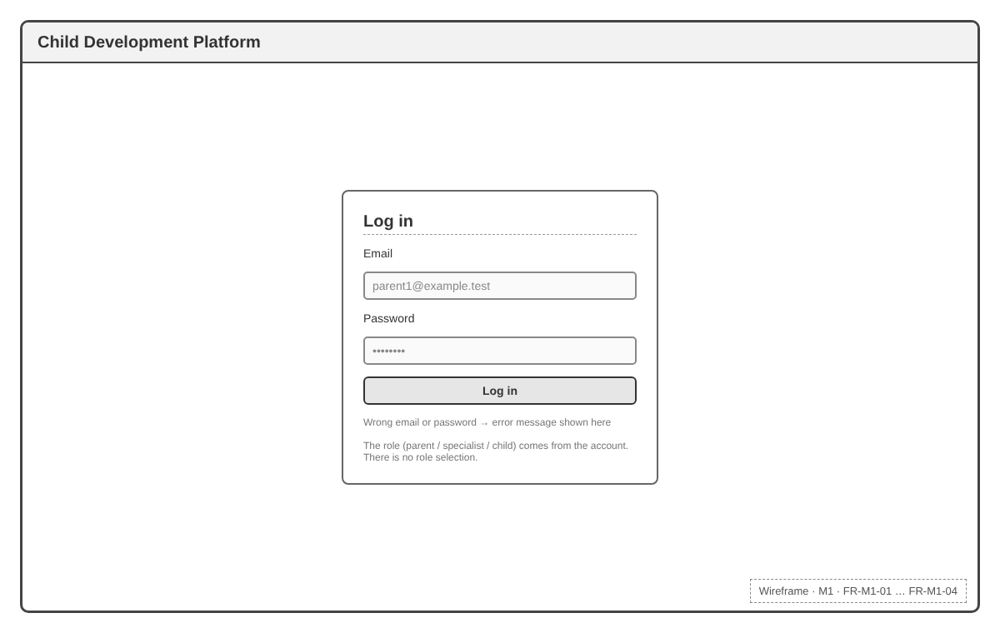

### Parent dashboard
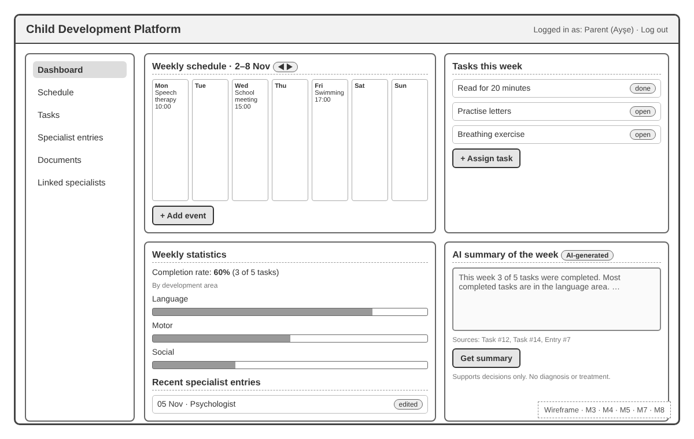

### Linked specialists
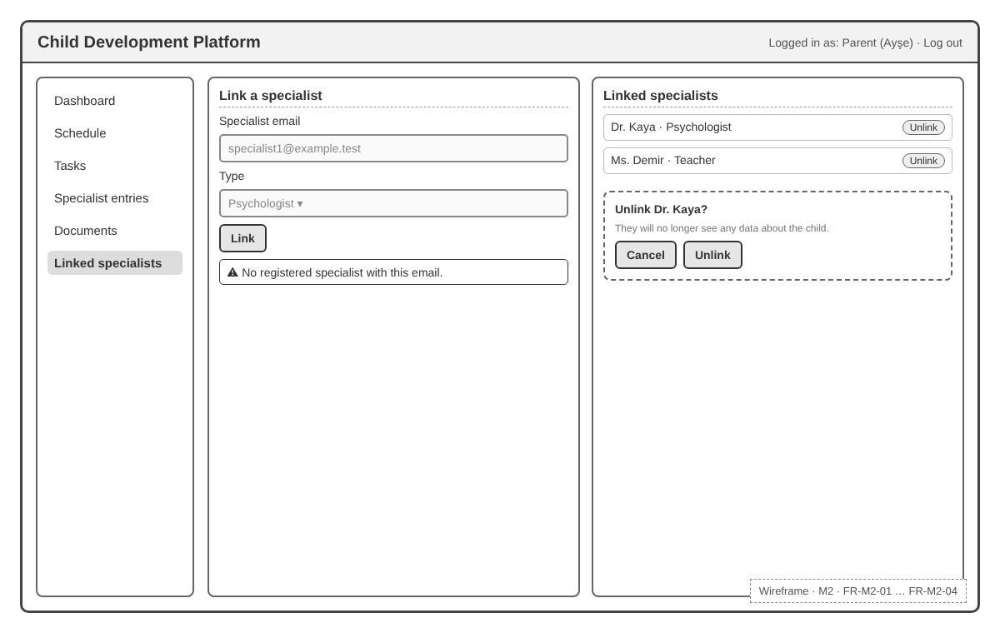

### Documents
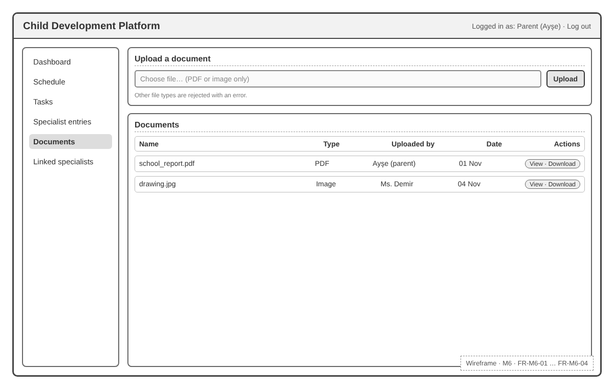

### Specialist: child profile and new entry
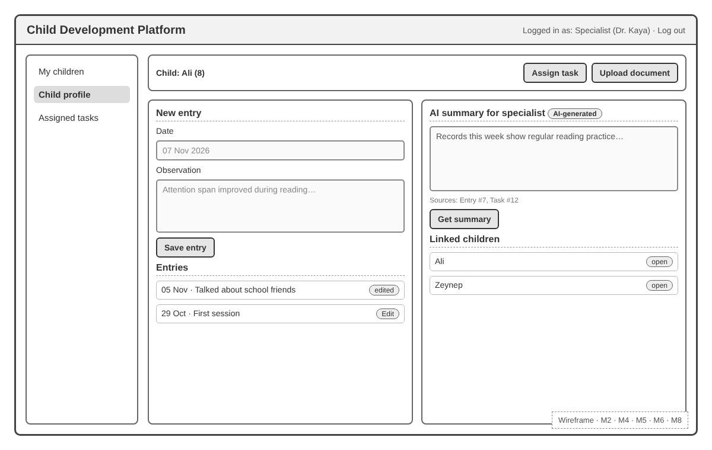

### Child: my tasks
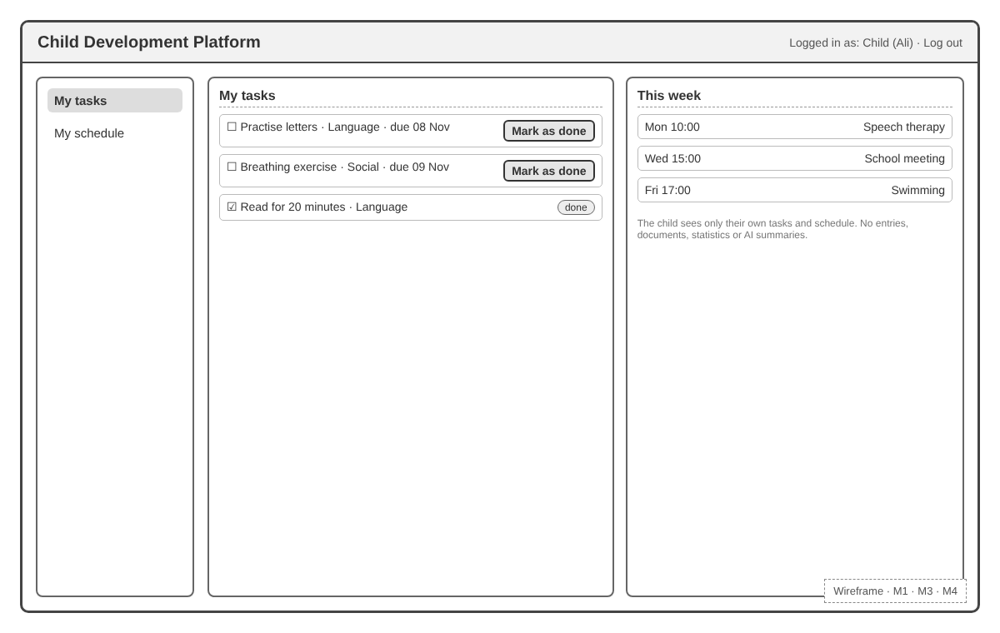

---

## 7. Change Log

| Date | Change | By |
|---|---|---|
| 2026-11-01 | First version | Selin Nur Seviş |
| 2026-11-07 | Added wireframes of the main screens (Section 6) | Selin Nur Seviş |
