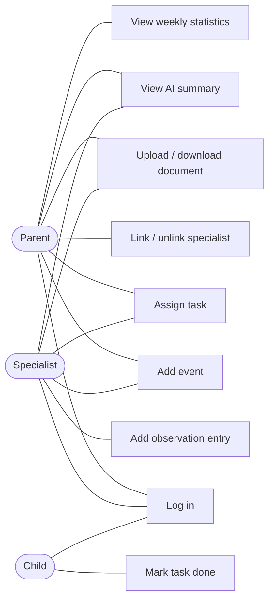

# Software Requirements Specification (SRS)

**Team name:** G4 (SENG383-SECTION1-G4)  
**Version:** ☒ First version (Week 6) ☐ Final (Week 10)  
**Last updated:** 2026-10-31

---

## 1. Introduction

**Purpose of the system:**
A child's development is followed by parents and several specialists who each keep their own notes and tasks. This web-based decision support platform brings them together around one shared weekly schedule, task list and record of observations. An AI component summarizes the week's records for each reader according to their role; the AI only supports decisions and never makes them.

**Users of the system:**

| User type | Description |
|---|---|
| Parent | Owns the child's data, sees all records, and links or unlinks specialists to the child. |
| Specialist | Teacher, psychologist, doctor, special education teacher or coach. Works only with the children they are linked to. |
| Child | Sees only their own tasks and schedule, and marks tasks as done. |

---

## 2. Functional Requirements

### M1 – Login and roles

| ID | Requirement | Priority |
|---|---|---|
| FR-M1-01 | The system shall allow a registered user to log in with email and password. | Must |
| FR-M1-02 | The system shall reject a login with a wrong email or password and show an error message. | Must |
| FR-M1-03 | The system shall take the user's role (parent, specialist, child) from the account; the user shall not choose the role at login. | Must |
| FR-M1-04 | The system shall show each role only its own screens. | Must |
| FR-M1-05 | The API shall reject requests without a valid JWT token with HTTP 401. | Must |

### M2 – Linking specialists

| ID | Requirement | Priority |
|---|---|---|
| FR-M2-01 | The system shall allow a parent to link a registered specialist to their child by email and specialist type. | Must |
| FR-M2-02 | The system shall show an error when the parent enters an email that does not belong to a registered specialist. | Must |
| FR-M2-03 | The system shall list the specialists linked to the child. | Must |
| FR-M2-04 | The system shall allow a parent to unlink a specialist after a confirmation step. | Must |
| FR-M2-05 | The API shall return HTTP 403 for every request a specialist makes about a child they are not linked to. | Must |
| FR-M2-06 | The system shall show a specialist the list of children they are linked to. | Must |

### M3 – Weekly schedule

| ID | Requirement | Priority |
|---|---|---|
| FR-M3-01 | The system shall allow the parent and linked specialists to add an event with a title, date and time to the child's schedule. | Must |
| FR-M3-02 | The system shall list the events of a selected week in a weekly view. | Must |
| FR-M3-03 | The system shall show the child their own events for the current week. | Must |

### M4 – Tasks

| ID | Requirement | Priority |
|---|---|---|
| FR-M4-01 | The system shall allow the parent and linked specialists to assign a task with a title, description, development area and due date. | Must |
| FR-M4-02 | The system shall show the child only their own tasks. | Must |
| FR-M4-03 | The system shall allow the child to mark a task as done. | Must |
| FR-M4-04 | The system shall show the assigner the status (open / done) of the tasks they assigned. | Must |

### M5 – Specialist entries

| ID | Requirement | Priority |
|---|---|---|
| FR-M5-01 | The system shall allow a linked specialist to add a dated observation entry about the child. | Must |
| FR-M5-02 | The system shall allow the author to edit their entry and shall mark an edited entry as "edited". | Must |
| FR-M5-03 | The system shall show entries to the parent and linked specialists. | Must |
| FR-M5-04 | The system shall not show entries to the child, in the UI or through the API. | Must |

### M6 – Documents

| ID | Requirement | Priority |
|---|---|---|
| FR-M6-01 | The system shall allow the parent and linked specialists to upload a PDF or image file for the child. | Must |
| FR-M6-02 | The system shall reject files that are not PDF or image files. | Must |
| FR-M6-03 | The system shall list documents with name, type, uploader and upload date. | Must |
| FR-M6-04 | The system shall allow the parent and linked specialists to view and download a document. | Must |
| FR-M6-05 | The system shall not show documents to the child, in the UI or through the API. | Must |

### M7 – Weekly statistics

| ID | Requirement | Priority |
|---|---|---|
| FR-M7-01 | The system shall show the task completion rate for a selected week as a percentage of tasks due in that week. | Must |
| FR-M7-02 | The system shall show the completion rate for the selected week broken down by development area. | Must |

### M8 – Role-based AI summary

| ID | Requirement | Priority |
|---|---|---|
| FR-M8-01 | The system shall generate a summary of the selected week's records for the child. | Must |
| FR-M8-02 | The system shall use a separate prompt for the parent and for the specialist. | Must |
| FR-M8-03 | The system shall label every summary as "AI-generated". | Must |
| FR-M8-04 | The system shall link each summary to the source records it is based on. | Must |
| FR-M8-05 | The system shall send the AI only data the reader is allowed to see. | Must |
| FR-M8-06 | The AI summary shall not make decisions or suggest a diagnosis or treatment. | Must |
| FR-M8-07 | The system shall provide a mock AI mode that returns a fixed summary, used in tests and CI. | Must |

---

## 3. Non-Functional Requirements

| ID | Category | Requirement |
|---|---|---|
| NFR-01 | Security | Passwords are stored hashed (bcrypt); plain-text passwords are never stored or logged. |
| NFR-02 | Security | Every API endpoint that returns child data checks the user's role and link to the child on the server side. |
| NFR-03 | Data | The system uses only synthetic data created by a seed script; no real personal data is stored. |
| NFR-04 | Installability | The application starts locally by following the README, with a single command each for backend and frontend. |
| NFR-05 | Testability | Branch coverage is at least 40% at v0.2 and at least 60% at v1.0. |

---

## 4. Critical Flows and Acceptance Criteria

| Flow | Related requirements | Acceptance criteria |
|---|---|---|
| Flow 1: Parent links a specialist; unlinked specialist is blocked | FR-M1-01, FR-M2-01, FR-M2-04, FR-M2-05 | **Given** a logged-in parent and a registered specialist **When** the parent links the specialist by email **Then** the specialist sees the child in their list. **When** the parent unlinks the specialist **Then** every API request by that specialist about the child returns 403. |
| Flow 2: Specialist assigns a task, child completes it | FR-M4-01, FR-M4-03, FR-M4-04 | **Given** a specialist linked to a child **When** the specialist assigns a task and the child marks it as done **Then** the specialist sees the task's status as "done". |
| Flow 3: Parent views the weekly AI summary | FR-M8-01, FR-M8-03, FR-M8-04, FR-M8-07 | **Given** a child with entries and tasks in the selected week and the AI in mock mode **When** the parent opens the weekly summary **Then** the summary is labelled "AI-generated" and links to its source records. |

---

## 5. Use Case Diagram (optional)

---

## 6. Change Log

| Date | Change | By |
|---|---|---|
| 2026-10-31 | First version | Selin Nur Seviş |
